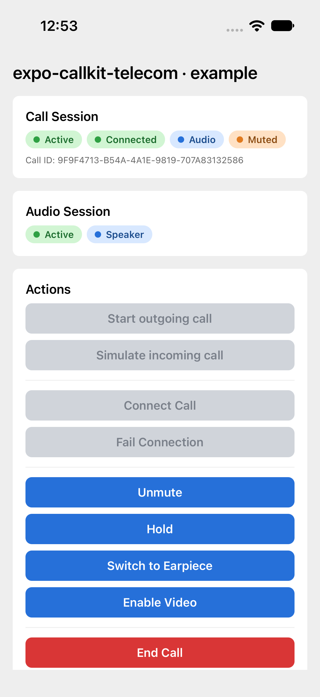

# Push isolation — native/React Native checkpoint

Acceptance: malformed synthetic PushKit delivery B must preserve the identity and
connected state of an existing call A, and A must still accept a native mute
transaction and end normally.

**Measured pass:** library `eae5e37`, simulator fixture `b7a33ab`, Xcode/SDK 27.1,
iOS 27.0 simulator, iPhone 17 Pro. The full Release Expo example and UI test bundle
built; XCTest passed in 22.063 seconds and the runner exited zero. Its run-owned
simulator and temporary fixture libraries were deleted. Existing simulators,
accessibility/display settings and physical devices were untouched.

The test uses actual Expo/native/JS code, the bundled WebRTC framework and genuine
CallKit objects with the separate simulator discovery runtime. It explicitly
triggers the malformed fixture after connection, requires a completion receipt
from the **metadata** API, compares A's UUID before/after, tests mute, and requires
final UUID removal plus a reenabled start button. No APNs credentials were used.

The original screenshot was inspected at normal phone resolution: the same call
remains Connected and Muted with the audio session active. No token appears in
this screenshot. The compact [result](result.json) excludes raw application logs;
the example currently logs its VoIP token, so raw `.xcresult` stays private.

## Hosted result

[GitHub run 39511821416](https://github.com/ziahamza/expo-callkit-telecom/actions/runs/39511821416)
also passes this real Expo/native/JS regression with **Xcode 26.6 / SDK 26.5 /
iOS 26.5** on macOS 26.6.2. The synthetic merge checkout is
`56cbe6f25ce61a6a36ae6a48f7bef238da80ce37`; the pinned runtime is `b7a33ab`.
The public [summary and environment](hosted-39511821416/) contain no raw app logs.

This proves application/native connected state and genuine CallKit transaction
delivery under the simulator runtime. It does not exercise a network peer,
provider signaling or two-party media. Xcode Cloud and third-party simulator
provider bootstrap environments remain unqualified.

The Xcode 26.3 / SDK 26.2 lane in this run exits 65 during native build before
XCTest; no compiler error was retained. It remains unclassified. The next harness
revision records its failure phase and bounded pre-launch compiler diagnostics.

## Negative control catches the original failure

The same XCTest was run against an isolated checkout that deliberately restores
ordinary invalid-call session creation followed by `store.firstSession` teardown.
A connected successfully, the explicitly triggered metadata push B completed,
then `XCTAssertTrue(connected.exists)` at line 70 **failed**: A was gone. The
runner exited **65**, with exactly one failed test. This is an application
assertion failure, not a failed build, absent fixture, or startup timeout.

The original [failure screenshot](negative-control/call-a-lost.png) was inspected:
Call Session is Inactive, Call ID is none, and call controls are disabled. The
[structured result](negative-control/result.json), environment, stage receipt
and [reproduction patch](negative-control/restore-wrong-first-session.patch) are
retained. Apply the patch to `35dc7ca` in a disposable checkout and commit it
before running the same QA script; tracked QA/native sources otherwise match.
The intentionally broken commit was local only, not a feature-branch change.

The first failed-control attempt also exposed Xcode's automatic failure
sysdiagnose exceeding the runner deadline. The final run disables that verbose
collection, preserves the test's explicit screenshot/hierarchy attachments and
finishes normally with the expected assertion failure. Earlier dependency/startup
failures and the incomplete result are not counted as negative-control proof.

## Implemented

- Carried upstream [PR #29](https://github.com/mfairley/expo-callkit-telecom/pull/29),
  preserving Tor Håkon Ingerson Moen / t0rs's commits and attribution. Invalid
  payloads report/end their own UUID without creating an application session,
  preparing audio or emitting ghost events. Placeholder Answer/End guards are
  retained. Failed reports now release their marker.
- A small typed Objective-C delegate adapter uses the exact metadata selector and
  a header feature guard. Swift never references the newer SDK type. Legacy
  delivery remains required-report behavior. Both compiler branches pass Clang
  checks with the local SDK; actual older-SDK qualification belongs to hosted CI.
- Typed plugin option `optionalVoIPPushPolicy` defaults to `reportAll`.
  `ignoreInvalidPayloads` skips only malformed optional pushes. Valid invitations
  still report; required pushes always take the reporting path.
- A native XCTest regression target is added only to generated Xcode files.
  Example buttons now expose correct button/disabled accessibility semantics,
  and the call UUID is available for identity assertions.
- Failure screenshots/hierarchy are captured before termination. The fixture uses
  unique cross-process trigger/receipt names. Receipts are not exactly-once proof.

## Review and other checks

Independent reviews checked native SDK compatibility, delegate retention, policy,
CI, identity assertions, scheduling and cleanup. Fixed review findings included
ambiguous “Inactive” matching, missing identity proof, timer-based injection,
staged-source provenance and missing packaging inputs in the source/CI gates.

Root TypeScript/plugin typecheck and build pass. The four existing plugin tests
pass. Lint exits zero with pre-existing warnings in unchanged `src/` files. The
full generated Expo app compiles and links the adapter. No unit suite was added.

## Limits

This is one end-to-end regression, not complete calling-library qualification.
The runtime is still the discovery prototype; independent two-way media, actual
APNs reporting/watchdog/cold launches, device behavior and the new Swift Package
are not established by this result. System call-screen UI remains separate work.

Successful placeholder UUID markers remain retained for the process lifetime,
as inherited from #29. A valid report can also race asynchronous session
publication/reset. Those lifecycle issues need explicit ownership/generation
handling; an arbitrary eviction timer would weaken delayed-action protection.
Duplicate/cancellation payload semantics are not newly invented in this patch.

See [the regression runner](../../../example/qa/README.md) for reproduction.
